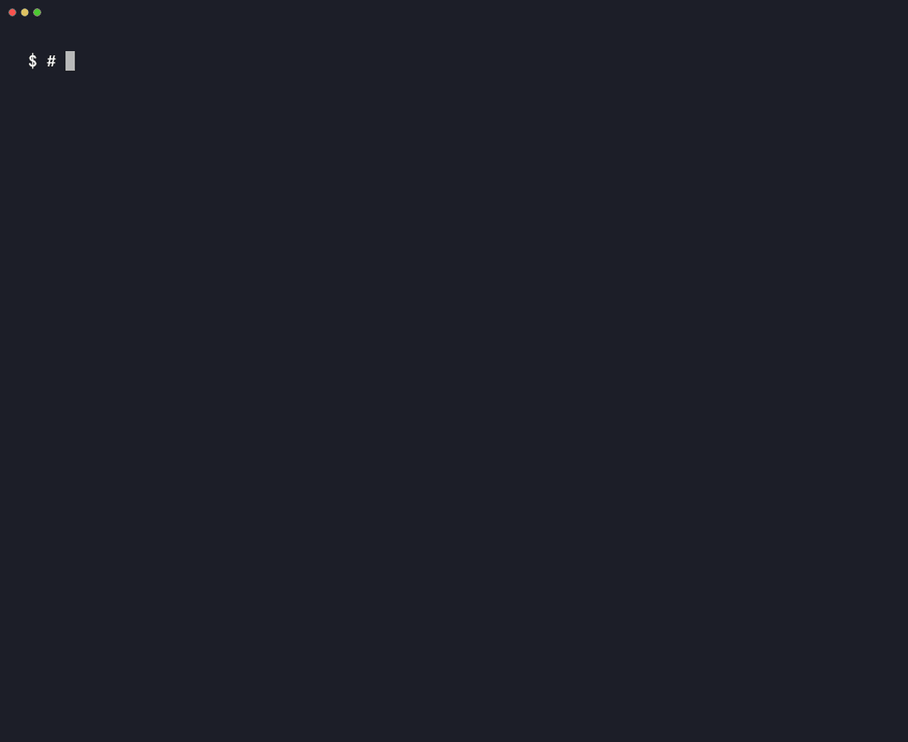

# ciguse

Log nicotine use from the terminal, one word at a time, and see how it tracks your work with coding agents. Local only: no account, no network, no telemetry.



Status: early. Logging, daily reports and the Claude Code plugin work; the report that compares working and waiting time is next.

## Install

**macOS (Homebrew)**

```sh
brew install demetriusk/tap/ciguse
```

**macOS / Linux (script)**

```sh
curl -fsSL https://raw.githubusercontent.com/demetriusk/ciguse/main/install.sh | sh
```

**Windows (PowerShell)**

```powershell
irm https://raw.githubusercontent.com/demetriusk/ciguse/main/install.ps1 | iex
```

**Manual:** download the archive for your system from [Releases](https://github.com/demetriusk/ciguse/releases), check it against `checksums.txt`, and put `ciguse` on your PATH.

**From source:** `go install github.com/demetriusk/ciguse@latest`

## Use

```sh
ciguse init              # set up: asks what you use, pack price, when your day ends
ciguse use               # log one use of your default product
ciguse use iqos          # cigarette, iqos, glo, stick, pouch
ciguse use --ago 10m     # forgot to log it
ciguse undo              # remove the last log from the past 24h
ciguse report            # last 14 days
```

`ciguse init` takes flags too, for scripts:

```sh
ciguse init --product iqos --pack-price 6.00 --currency EUR --pack-size 20
ciguse init --day-start 04:00   # late nights count toward the previous day
```

Colors follow your terminal's theme and switch off with `NO_COLOR` or when output isn't a terminal.

A second log within 90 seconds is treated as an accidental repeat and skipped; `--force` logs it anyway.

## Claude Code

The plugin records when Claude Code is working and when it's waiting on you. It needs ciguse 0.2.0 or later on your PATH (`brew upgrade ciguse`); older versions record nothing.

```text
/plugin install ciguse --marketplace demetriusk/ciguse
```

Per session it stores a keyed session id, a keyed project path, the repository's folder name, and when the state changed. Prompts, tool input, file paths and transcripts are never read into storage.

## Data

A SQLite file, the key used to hide session ids and paths, and an error log for the plugin, all readable only by your user:

- macOS: `~/Library/Application Support/ciguse/ciguse.db`
- Linux: `$XDG_DATA_HOME/ciguse/ciguse.db` (default `~/.local/share/ciguse`)
- Windows: `%LOCALAPPDATA%\ciguse\ciguse.db`

Set `CIGUSE_HOME` to use another directory.

## License

MIT
